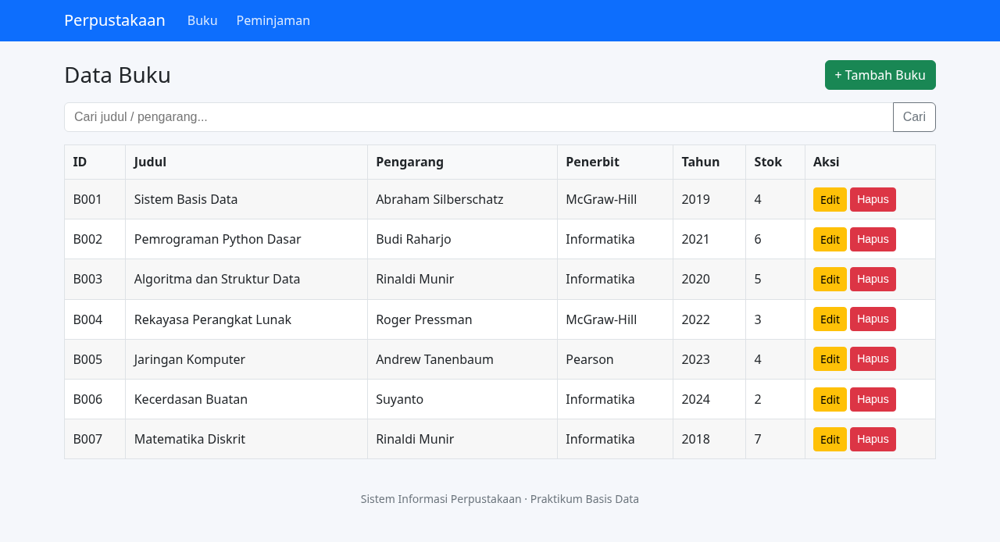
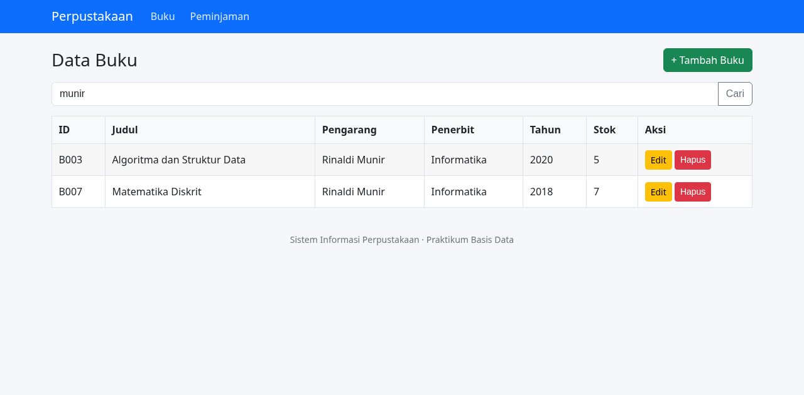
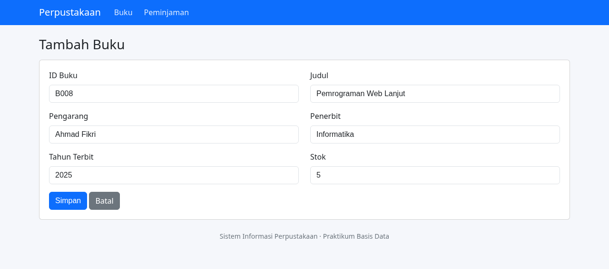
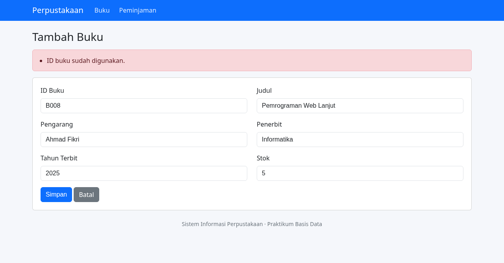
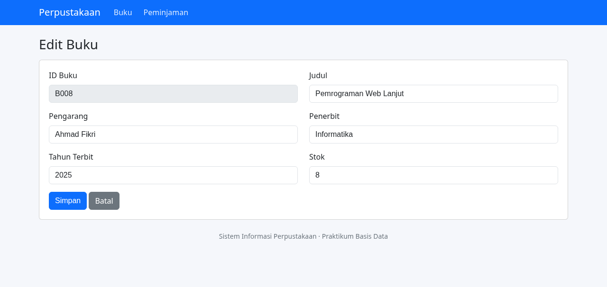
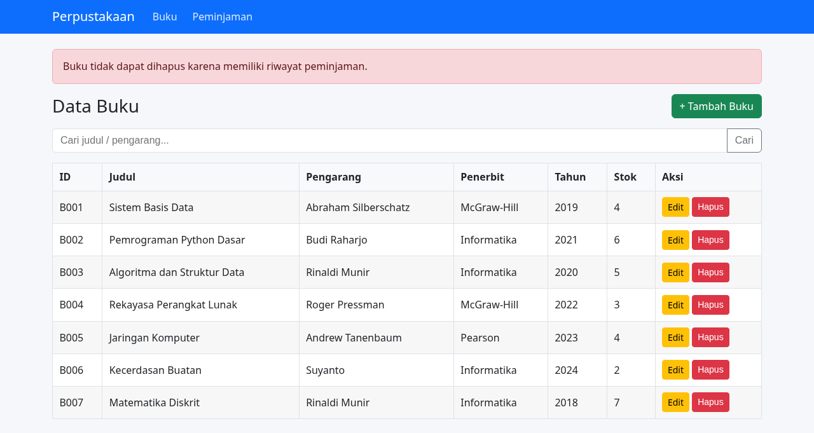
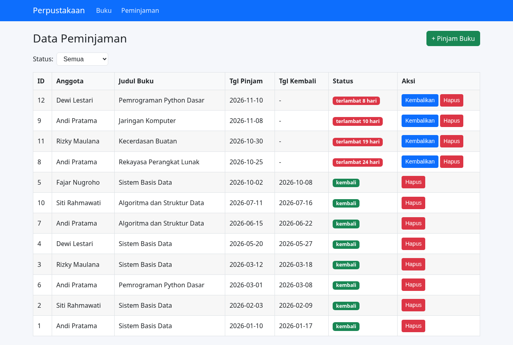

# Sistem Informasi Perpustakaan — CRUD Dasar (Python Flask)

Implementasi aplikasi **CRUD (Create, Read, Update, Delete)** untuk Studi Kasus 1 **Sistem Informasi Perpustakaan** (`db_perpustakaan`) menggunakan **Python (Flask)**, **PyMySQL**, dan **Bootstrap 5**.

Nama : Muhammad Fawwaz Alwan

Kelas: 2026D

NIM: 26091397125

## Teknologi yang Digunakan

- **Bahasa Pemrograman**: Python 3.10+
- **Web Framework**: Flask 3.x (Blueprint & Jinja2 Server-Side Rendering)
- **Basis Data**: MySQL / MariaDB (`InnoDB`, `utf8mb4`)
- **Driver Database**: PyMySQL + `cryptography`
- **Antarmuka (UI)**: Bootstrap 5.3.3 (CDN) + CSS kustom

## Fitur Utama

1. **Modul Buku (`/buku`)**
   - **Read**: Menampilkan daftar buku terurut berdasarkan `id_buku` serta fitur pencarian berdasarkan judul atau pengarang (`LIKE` dengan *prepared statement*).
   - **Create**: Menambah buku baru dengan validasi dua lapis (HTML & server-side), format ID `Bxxx`, serta penanganan duplikat *primary key* (MySQL error `1062`).
   - **Update**: Mengubah data buku dengan kolom `id_buku` bersifat `readonly`.
   - **Delete**: Menghapus buku via metode `POST` dengan perlindungan *foreign key* (MySQL error `1451` jika buku sudah memiliki riwayat peminjaman).
2. **Modul Peminjaman (`/peminjaman`)**
   - **Read**: Menampilkan transaksi peminjaman dengan `INNER JOIN` (`anggota` dan `buku`), filter status (`dipinjam` / `kembali`), serta penanda keterlambatan otomatis untuk batas pinjam 7 hari.
   - **Create**: Mencatat peminjaman baru menggunakan transaksi basis data (`SELECT ... FOR UPDATE`, `INSERT`, dan `UPDATE stok = stok - 1`).
   - **Update (Pengembalian)**: Memproses pengembalian buku dalam satu transaksi (`status = 'kembali'`, `tgl_kembali = CURDATE()`, dan `stok = stok + 1`).
   - **Delete**: Menghapus transaksi dengan pengembalian stok otomatis jika transaksi yang dihapus masih berstatus `dipinjam`.

## Struktur Project

```text
perpus-flask/
├── app.py                     # Titik masuk aplikasi & registrasi blueprint
├── config.py                  # Konfigurasi SECRET_KEY & koneksi MySQL
├── db.py                      # Manajemen koneksi PyMySQL per request
├── db_perpustakaan.sql        # Skrip pembuatan basis data & data awal
├── requirements.txt           # Daftar dependensi Python
├── jalankan.bat               # Pintasan menjalankan MariaDB + Flask di Windows
├── routes/
│   ├── __init__.py
│   ├── buku.py                # Route CRUD modul buku
│   └── peminjaman.py          # Route CRUD & transaksi modul peminjaman
├── static/
│   └── css/
│       └── style.css          # CSS tambahan
├── templates/
│   ├── base.html              # Template induk (navbar, flash message, footer)
│   ├── _errors.html           # Potongan daftar pesan error validasi
│   ├── buku/
│   │   ├── index.html         # Halaman daftar & pencarian buku
│   │   └── form.html          # Form tambah & edit buku
│   └── peminjaman/
│       ├── index.html         # Halaman daftar transaksi & filter status
│       └── form.html          # Form catat peminjaman baru
└── screenshots/               # Tangkapan layar hasil pengujian CRUD
```

## Cara Menjalankan Aplikasi

### 1. Persiapan Basis Data MySQL / MariaDB
1. Jalankan layanan **MySQL** (dan **Apache** jika menggunakan phpMyAdmin) melalui XAMPP atau Laragon.
2. Impor file `db_perpustakaan.sql` menggunakan salah satu cara berikut:
   - **Lewat phpMyAdmin (Disarankan)**:
     1. Buka `http://localhost/phpmyadmin` di browser.
     2. Langsung klik tab **Import** di menu bagian atas (tidak perlu memilih database terlebih dahulu).
     3. Klik **Choose File**, pilih file `db_perpustakaan.sql` dari folder proyek, lalu gulir ke bawah dan klik **Import / Go**.
     4. Pastikan database `db_perpustakaan` muncul di panel kiri dengan 3 tabel beserta datanya (`anggota` = 6 baris, `buku` = 7 baris, `peminjaman` = 12 baris).
   - **Lewat CMD (Windows)**:
     Pindah ke folder proyek terlebih dahulu, lalu jalankan:
     ```bat
     mysql -u root -p < db_perpustakaan.sql
     ```
     Saat diminta `Enter password:`, **langsung tekan Enter saja** (setup ini memakai XAMPP tanpa kata sandi). *(Bila MySQL kamu berpassword, ketik kata sandinya lalu tekan Enter.)*
   - **Lewat PowerShell (Windows)**:
     Pindah ke folder proyek terlebih dahulu, lalu jalankan:
     ```powershell
     Get-Content db_perpustakaan.sql | mysql -u root -p
     ```
     Saat diminta `Enter password:`, **langsung tekan Enter saja** (setup ini memakai XAMPP tanpa kata sandi).
3. Jika kredensial MySQL kamu berbeda, sesuaikan `DB_HOST`, `DB_USER`, `DB_PASSWORD`, dan `DB_NAME` di file `config.py` atau melalui *environment variable*.

   **Penting — `DB_PASSWORD` di `config.py` harus cocok dengan kata sandi MySQL kamu.** Pada setup ini MySQL `root` **tanpa kata sandi** (default XAMPP), dan `config.py` memakai `DB_PASSWORD = ''` (kosong) — jadi aplikasi langsung bisa tersambung tanpa perubahan tambahan.

   > Jika MySQL kamu berpassword, pastikan **ketiganya konsisten**: (1) kata sandi di MySQL, (2) `DB_PASSWORD` di `config.py`, dan (3) saat diminta password di CMD/PowerShell. Ketidakcocokan di antara ketiganya adalah penyebab error `Access denied for user 'root'@'localhost'`.

   **Cara A — lewat `config.py`** (paling mudah): buka file `config.py`, lalu ubah baris `DB_PASSWORD` menjadi kata sandi kamu. Jika tidak ada kata sandi, cukup biarkan kosong seperti `DB_PASSWORD = ''`.
   ```python
   DB_PASSWORD = 'kata-sandi-mysql-kamu'
   ```
   *(Baris `SECRET_KEY` boleh dibiarkan apa adanya — itu dipakai Flask untuk fitur session, bukan untuk MySQL.)*

   **Cara B — lewat *environment variable*** (tanpa mengubah `config.py`), jalankan sebelum `python app.py`:
   ```powershell
   # PowerShell
   $env:DB_PASSWORD = 'kata-sandi-mysql-kamu'
   python app.py
   ```
   ```bat
   REM CMD
   set DB_PASSWORD=kata-sandi-mysql-kamu
   python app.py
   ```

### 2. Menyiapkan Virtual Environment & Instalasi Dependensi
Buka terminal/CMD tepat di dalam folder proyek (di Windows: buka folder proyek lewat File Explorer, klik bilah alamat di bagian atas, ketik `cmd`, lalu tekan **Enter**), kemudian jalankan perintah sesuai sistem operasi:

**Windows (CMD):**
```bat
py -m venv venv
venv\Scripts\activate
pip install -r requirements.txt
```
*(Catatan: Gunakan `py` jika perintah `python` tidak dikenali di PATH Windows. Jika `python` sudah terdaftar di PATH, kamu boleh mengganti `py -m venv venv` menjadi `python -m venv venv`. Pastikan muncul tanda `(venv)` di awal baris CMD setelah aktivasi.)*

> **Jika `py -m venv venv` atau `pip install` diblokir** oleh kebijakan keamanan perangkat (pesan seperti *"Application Control policy has blocked this file"* atau *"blocked by your organization's Device Guard policy"*): laptop/komputermu memblokir eksekusi `.exe` di dalam folder `venv` (biasanya karena folder `Dokumen`). Gunakan Python **global** sebagai gantinya — install paket dan jalankan aplikasi **tanpa** `venv`:
>
> ```powershell
> # hapus venv yang rusak (jika ada), lalu install ke Python global
> Remove-Item -Recurse -Force venv
> py -m pip install -r requirements.txt
> py app.py
> ```
>
> Perintah `py app.py` ini setara dengan `python app.py` pada langkah 3 di bawah.

**Linux / macOS:**
```bash
python3 -m venv venv
source venv/bin/activate
pip install -r requirements.txt
```

### 3. Menjalankan Server Flask
Pastikan virtual environment `(venv)` sedang aktif dan layanan **MySQL** tetap menyala, lalu jalankan:

```bash
python app.py
```

Tunggu hingga muncul pesan `Running on http://127.0.0.1:5000`, kemudian buka **`http://127.0.0.1:5000`** di browser. Biarkan jendela terminal tetap terbuka selama aplikasi digunakan, dan tekan **`Ctrl + C`** untuk menghentikan server setelah selesai.

## Peta URL Aplikasi

| Metode | URL | Fungsi | Operasi |
| :--- | :--- | :--- | :--- |
| `GET` | `/buku/` | `buku.index` | Read daftar & pencarian buku |
| `GET`/`POST` | `/buku/tambah` | `buku.tambah` | Create buku baru |
| `GET`/`POST` | `/buku/<id_buku>/edit` | `buku.edit` | Update data buku |
| `POST` | `/buku/<id_buku>/hapus` | `buku.hapus` | Delete buku |
| `GET` | `/peminjaman/` | `peminjaman.index` | Read transaksi (JOIN + filter) |
| `GET`/`POST` | `/peminjaman/tambah` | `peminjaman.tambah` | Create transaksi peminjaman |
| `POST` | `/peminjaman/<id>/kembalikan` | `peminjaman.kembalikan` | Update pengembalian buku |
| `POST` | `/peminjaman/<id>/hapus` | `peminjaman.hapus` | Delete transaksi peminjaman |

## Tampilan Hasil & Pengujian CRUD

### 1. Halaman Daftar Buku (Read)
Menampilkan 7 data buku awal (`B001`–`B007`) beserta kolom pencarian dan tombol aksi.



### 2. Pencarian Buku (`?q=munir`)
Menyaring buku berdasarkan judul atau pengarang menggunakan *prepared statement*.



### 3. Form Tambah Buku (Create)
Menambahkan buku baru `B008` (*Pemrograman Web Lanjut*, stok `5`).



### 4. Buku Berhasil Ditambahkan (Pola PRG & Flash Message)
Setelah `INSERT` berhasil, aplikasi mengalihkan ke halaman daftar buku dengan pesan *flash* sukses.


### 5. Penanganan Duplikat Primary Key (MySQL Error 1062)
Menambahkan ID buku yang sudah ada (`B008`) ditolak dengan pesan error ramah di atas form.



### 6. Form Edit Buku (Update)
Mengubah data buku `B008` (stok menjadi `8`) dengan kolom `ID Buku` dikunci (`readonly`).



### 7. Perlindungan Foreign Key Saat Hapus Buku (MySQL Error 1451)
Penghapusan buku `B001` ditolak karena masih direferensikan oleh tabel `peminjaman`.



### 8. Halaman Daftar Peminjaman (Read dengan INNER JOIN)
Menampilkan 12 transaksi peminjaman lengkap dengan nama anggota, judul buku, filter status, dan *badge* keterlambatan.



### 9. Form Catat Peminjaman Baru (Create dengan Transaksi)
Memilih anggota (`A006 - Nadia Putri`) dan buku dengan stok tersedia (`Matematika Diskrit`).


### 10. Proses Pengembalian Buku (Update dengan Transaksi)
Status transaksi berubah menjadi `kembali`, `tgl_kembali` terisi otomatis, dan stok buku bertambah kembali.


