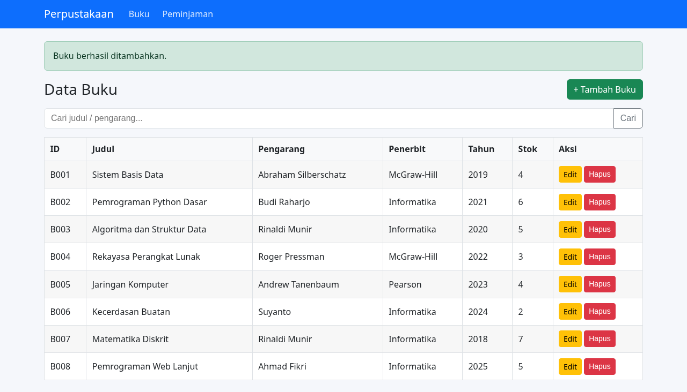
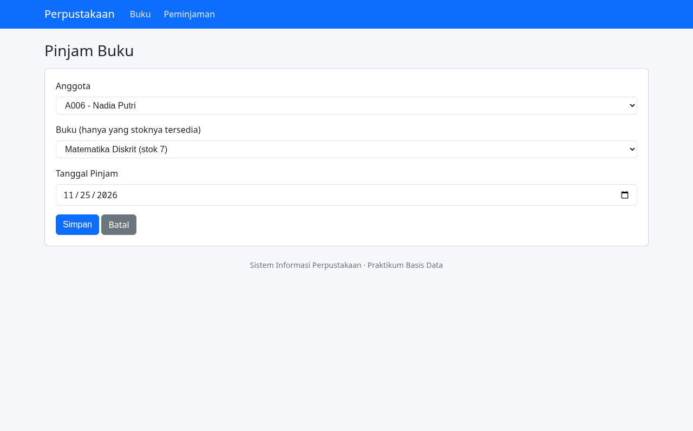
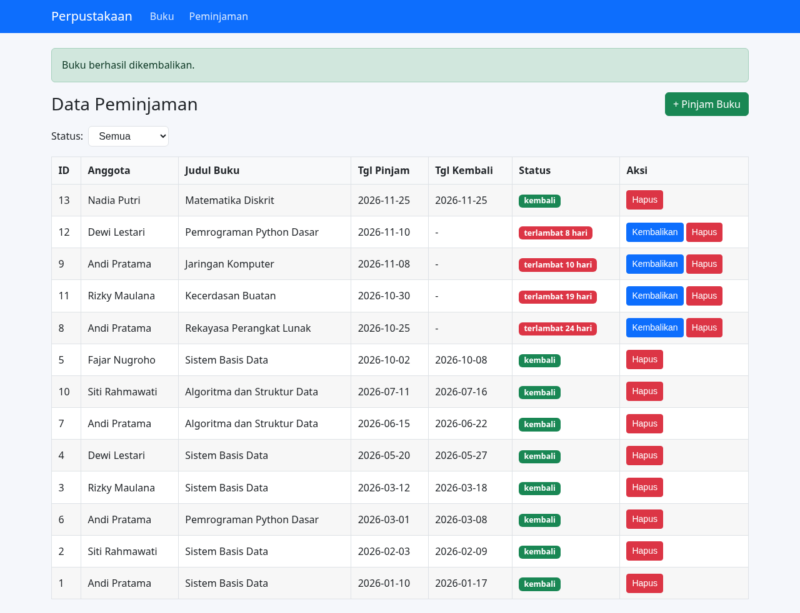

# Sistem Informasi Perpustakaan — CRUD Dasar (Python Flask)

Implementasi aplikasi **CRUD (Create, Read, Update, Delete)** untuk Studi Kasus 1 **Sistem Informasi Perpustakaan** (`db_perpustakaan`) menggunakan **Python (Flask)**, **PyMySQL**, dan **Bootstrap 5**.

## Teknologi yang Digunakan

- **Bahasa Pemrograman**: Python 3.10+
- **Web Framework**: Flask 3.x (Blueprint & Jinja2 Server-Side Rendering)
- **Basis Data**: MySQL / MariaDB (`InnoDB`, `utf8mb4`)
- **Driver Database**: PyMySQL + `cryptography`
- **Antarmuka (UI)**: Bootstrap 5.3.3 (CDN) + CSS kustom

## Fitur Utama

1. **Modul Buku (`/buku`)**
   - **Read**: Menampilkan daftar buku terurut berdasarkan `id_buku` serta fitur pencarian berdasarkan judul atau pengarang (`LIKE` dengan *prepared statement*).
   - **Create**: Menambah buku baru dengan validasi dua lapis (HTML & server-side), format ID `Bxxx`, serta penanganan duplikat *primary key* (MySQL error `1062`).
   - **Update**: Mengubah data buku dengan kolom `id_buku` bersifat `readonly`.
   - **Delete**: Menghapus buku via metode `POST` dengan perlindungan *foreign key* (MySQL error `1451` jika buku sudah memiliki riwayat peminjaman).
2. **Modul Peminjaman (`/peminjaman`)**
   - **Read**: Menampilkan transaksi peminjaman dengan `INNER JOIN` (`anggota` dan `buku`), filter status (`dipinjam` / `kembali`), serta penanda keterlambatan otomatis untuk batas pinjam 7 hari.
   - **Create**: Mencatat peminjaman baru menggunakan transaksi basis data (`SELECT ... FOR UPDATE`, `INSERT`, dan `UPDATE stok = stok - 1`).
   - **Update (Pengembalian)**: Memproses pengembalian buku dalam satu transaksi (`status = 'kembali'`, `tgl_kembali = CURDATE()`, dan `stok = stok + 1`).
   - **Delete**: Menghapus transaksi dengan pengembalian stok otomatis jika transaksi yang dihapus masih berstatus `dipinjam`.

## Struktur Project

```text
perpus-flask/
├── app.py                     # Titik masuk aplikasi & registrasi blueprint
├── config.py                  # Konfigurasi SECRET_KEY & koneksi MySQL
├── db.py                      # Manajemen koneksi PyMySQL per request
├── db_perpustakaan.sql        # Skrip pembuatan basis data & data awal
├── requirements.txt           # Daftar dependensi Python
├── routes/
│   ├── __init__.py
│   ├── buku.py                # Route CRUD modul buku
│   └── peminjaman.py          # Route CRUD & transaksi modul peminjaman
├── static/
│   └── css/
│       └── style.css          # CSS tambahan
├── templates/
│   ├── base.html              # Template induk (navbar, flash message, footer)
│   ├── _errors.html           # Potongan daftar pesan error validasi
│   ├── buku/
│   │   ├── index.html         # Halaman daftar & pencarian buku
│   │   └── form.html          # Form tambah & edit buku
│   └── peminjaman/
│       ├── index.html         # Halaman daftar transaksi & filter status
│       └── form.html          # Form catat peminjaman baru
└── screenshots/               # Tangkapan layar hasil pengujian CRUD
```

## Cara Menjalankan Aplikasi

### 1. Persiapan Basis Data MySQL / MariaDB
Pastikan layanan MySQL/MariaDB (misalnya melalui XAMPP atau Laragon) sudah aktif, lalu impor `db_perpustakaan.sql` melalui phpMyAdmin atau terminal:

```bash
mysql -u root -p < db_perpustakaan.sql
```

Sesuaikan konfigurasi koneksi di `config.py` (atau melalui *environment variable* `DB_HOST`, `DB_USER`, `DB_PASSWORD`, `DB_NAME`) apabila kredensial MySQL berbeda dari bawaan XAMPP (`root` tanpa kata sandi).

### 2. Menyiapkan Virtual Environment & Dependensi

```bash
python -m venv venv

# Windows
venv\Scripts\activate

# Linux / macOS
source venv/bin/activate

pip install -r requirements.txt
```

### 3. Menjalankan Server Flask

```bash
flask --app app run --debug
# atau
python app.py
```

Buka browser dan akses `http://127.0.0.1:5000`.

## Peta URL Aplikasi

| Metode | URL | Fungsi | Operasi |
| :--- | :--- | :--- | :--- |
| `GET` | `/buku/` | `buku.index` | Read daftar & pencarian buku |
| `GET`/`POST` | `/buku/tambah` | `buku.tambah` | Create buku baru |
| `GET`/`POST` | `/buku/<id_buku>/edit` | `buku.edit` | Update data buku |
| `POST` | `/buku/<id_buku>/hapus` | `buku.hapus` | Delete buku |
| `GET` | `/peminjaman/` | `peminjaman.index` | Read transaksi (JOIN + filter) |
| `GET`/`POST` | `/peminjaman/tambah` | `peminjaman.tambah` | Create transaksi peminjaman |
| `POST` | `/peminjaman/<id>/kembalikan` | `peminjaman.kembalikan` | Update pengembalian buku |
| `POST` | `/peminjaman/<id>/hapus` | `peminjaman.hapus` | Delete transaksi peminjaman |

## Tampilan Hasil & Pengujian CRUD

### 1. Halaman Daftar Buku (Read)
Menampilkan 7 data buku awal (`B001`–`B007`) beserta kolom pencarian dan tombol aksi.


### 2. Pencarian Buku (`?q=munir`)
Menyaring buku berdasarkan judul atau pengarang menggunakan *prepared statement*.


### 3. Form Tambah Buku (Create)
Menambahkan buku baru `B008` (*Pemrograman Web Lanjut*, stok `5`).


### 4. Buku Berhasil Ditambahkan (Pola PRG & Flash Message)
Setelah `INSERT` berhasil, aplikasi mengalihkan ke halaman daftar buku dengan pesan *flash* sukses.



### 5. Penanganan Duplikat Primary Key (MySQL Error 1062)
Menambahkan ID buku yang sudah ada (`B008`) ditolak dengan pesan error ramah di atas form.


### 6. Form Edit Buku (Update)
Mengubah data buku `B008` (stok menjadi `8`) dengan kolom `ID Buku` dikunci (`readonly`).


### 7. Perlindungan Foreign Key Saat Hapus Buku (MySQL Error 1451)
Penghapusan buku `B001` ditolak karena masih direferensikan oleh tabel `peminjaman`.


### 8. Halaman Daftar Peminjaman (Read dengan INNER JOIN)
Menampilkan 12 transaksi peminjaman lengkap dengan nama anggota, judul buku, filter status, dan *badge* keterlambatan.


### 9. Form Catat Peminjaman Baru (Create dengan Transaksi)
Memilih anggota (`A006 - Nadia Putri`) dan buku dengan stok tersedia (`Matematika Diskrit`).



### 10. Proses Pengembalian Buku (Update dengan Transaksi)
Status transaksi berubah menjadi `kembali`, `tgl_kembali` terisi otomatis, dan stok buku bertambah kembali.


